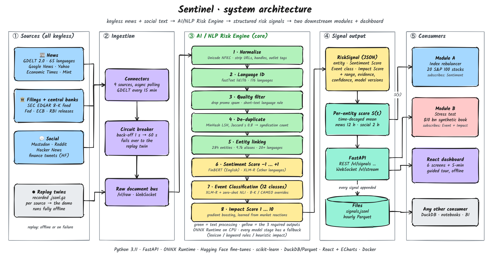
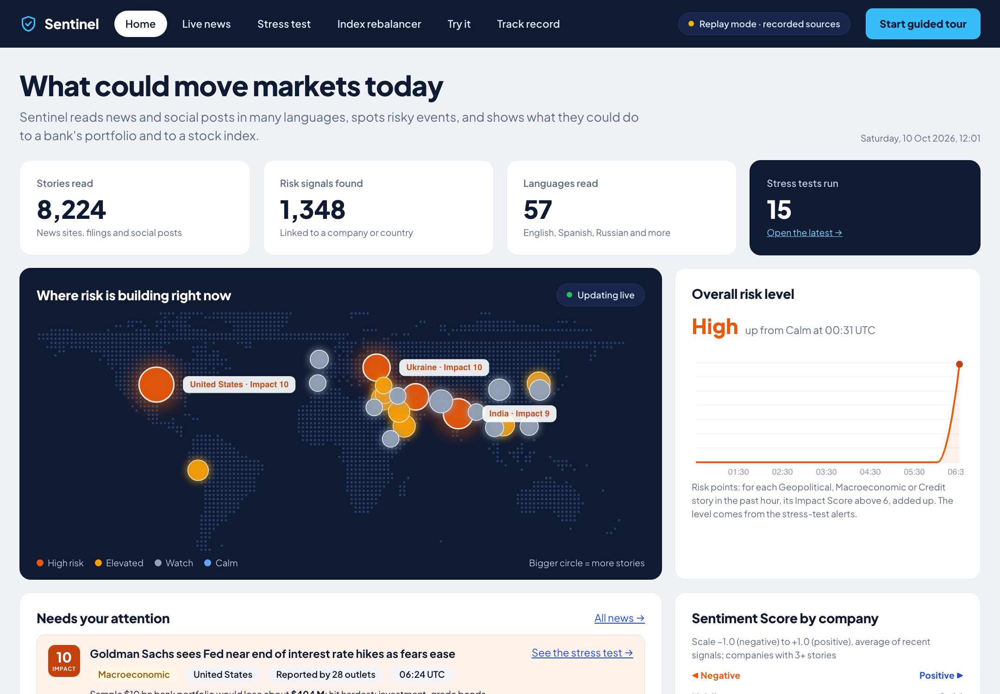
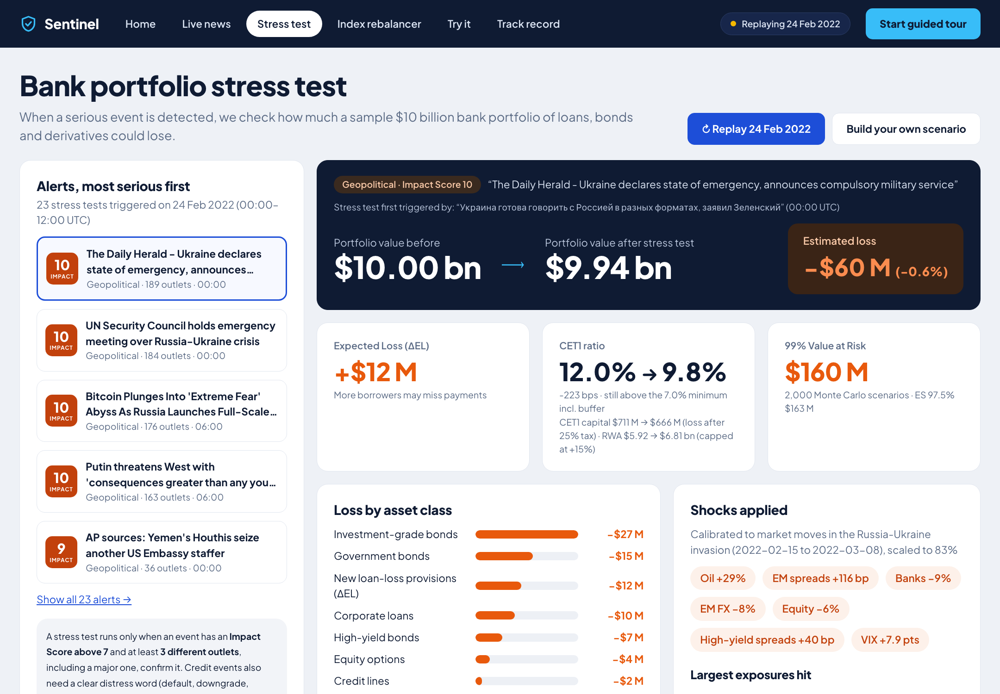
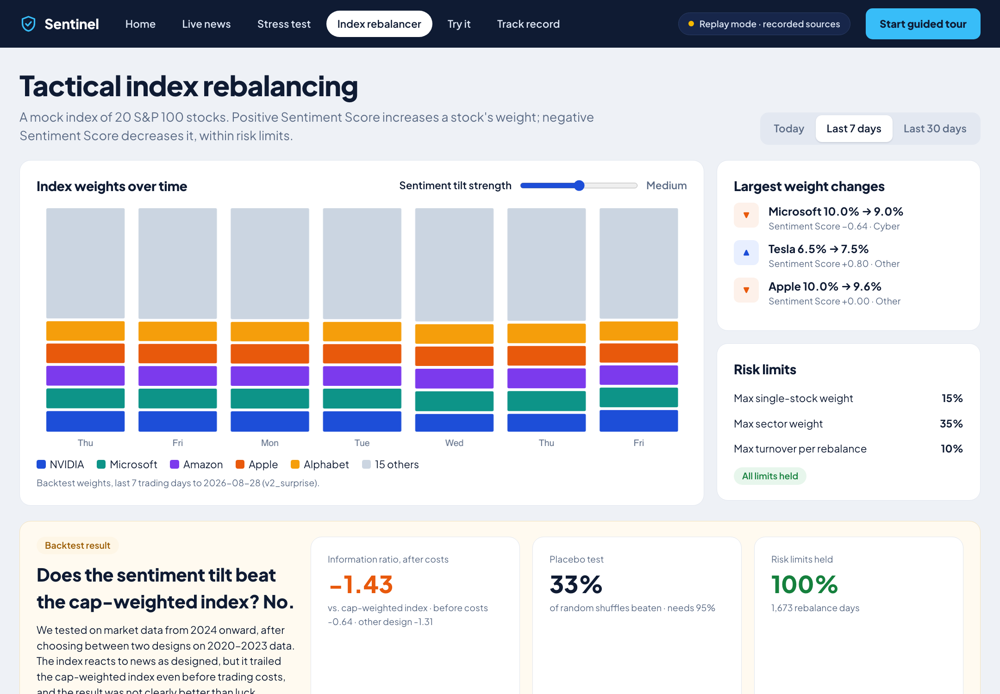
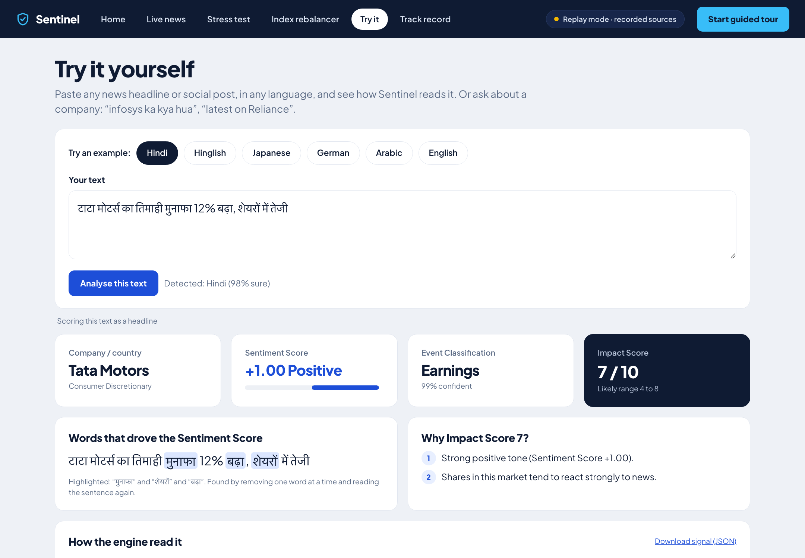

# Sentinel: Global Risk Signal Engine - S&P Global & Crisil Campus Hackathon

**Candidate Name:** Yugh Juneja
**College Email ID:** yugh.23bce11163@vitbhopal.ac.in
**College / Campus:** VIT Bhopal University
**Demo Video Link:** `<YouTube, unlisted>`
**Slide Deck Link (if hosted externally):** in the repo at [docs/presentation.pdf](docs/presentation.pdf) (7 slides; also [PPTX](docs/presentation.pptx))

> **Sentinel reads financial news and social posts in many languages and turns each story into three numbers for every
> company or country it mentions: a Sentiment Score (−1 to +1), an Event Classification (12 types) and an Impact Score
> (1 to 10) learned from real market reactions.** Those signals drive two working tools: **Module A**, an index that tilts
> towards good news within risk limits, and **Module B**, a stress test that re-prices a $10 bn bank portfolio when a serious
> event is confirmed. Everything runs on a laptop CPU, needs no API keys, and works offline.

<p align="center">
  <a href="docs/architecture.png"></a>
  <br><sub>System architecture (click for full size). More diagrams in <a href="#diagrams">section 2</a>.</sub>
</p>

---

## 1. Project Overview / Problem Statement & Approach

**The problem.** Market-moving risk reaches a bank as text: news wires, regulatory filings, central-bank statements and
social posts, in dozens of languages and far faster than analysts can read them. Within minutes of a story a risk desk
needs four answers: **who** is affected, **how** the news reads, **what kind** of event it is, and **how much** it could
cost the portfolio. Keyword alerts miss context, ignore non-English sources and cannot put a number on the risk.

**The approach.** Sentinel is a streaming pipeline in five steps:
1. **Collect** text from 9 free, keyless sources (GDELT in 65 languages, Google News, Yahoo Finance, Economic Times, Mint,
   SEC 8-K filings, Fed/ECB/RBI, Mastodon, Reddit, Hacker News, finance tweets). Every source has a recorded replay, so the
   system never goes dark.
2. **Clean and link**: detect the language, drop spam and duplicates, and find the companies and countries mentioned
   (284 entities, 9.7k names in 20+ languages).
3. **Score** with fine-tuned language models: sentiment per company (FinBERT for English, XLM-RoBERTa plus a multilingual
   NLI model for other languages) and the event type; then an **Impact Score** from a model trained on how prices actually
   moved after 74,964 past news items.
4. **Deliver** one structured signal per company per story, over REST, WebSocket and files.
5. **Act**: Module A re-weights a 20-stock index; Module B runs a stress test when a serious event is confirmed by several
   news outlets, and reports the loss and the capital impact.

**Result in one line:** replaying the real news of **24 Feb 2022**, Sentinel turned 11,520 articles into 3,107 signals and
**23 stress tests**. The first fired at 00:00 UTC from Russian-language headlines, and each one was sized in dollars and in
capital ratio.

### How the case study is covered

| Requirement in the case study | What Sentinel delivers | Where |
| --- | --- | --- |
| Ingest text from at least 2 sources (e.g. news + Twitter/X) | 9 keyless sources, news + social, 65 languages | `src/engine/ingest/` |
| Sentiment Score −1.0 to 1.0 | Per company, from fine-tuned FinBERT (English) and XLM-RoBERTa + NLI (other languages) | `src/engine/nlp/sentiment.py` |
| Event Classification (Geopolitical, Macro, Credit, M&A, Product Launch, …) | 12 classes, including all 5 named in the brief | `src/engine/nlp/events.py` |
| Impact Score 1–10 | Learned from 74,964 news → price-move pairs, with a likely range and the reasons | `src/engine/impact/` |
| Output via API or file | REST + WebSocket (FastAPI), `signals.jsonl`, hourly Parquet | `src/engine/api/` |
| At least 1 downstream module | Both Module A (index rebalancer) and Module B (stress test), each with a dashboard screen | `src/modules/`, `src/web/` |

---

## 2. Architecture & Tech Stack

**Data flow.** Sources → ingestion (circuit breaker + replay twin per source) → NLP Risk Engine (normalise → language ID →
spam filter → de-duplicate → entity linking → sentiment → event → impact) → one `RiskSignal` per company → API, files and
the dashboard → Module A and Module B. The diagram at the top shows the full picture.

### Diagrams

Each diagram opens full size; editable Excalidraw sources are in [`docs/diagrams/source/`](docs/diagrams/source/).

| Diagram | What it shows |
| --- | --- |
| [System architecture](docs/diagrams/architecture.png) | Sources → ingestion → NLP engine → signal output → consumers |
| [One headline through the engine](docs/diagrams/signal-walkthrough.png) | A real Hindi headline at every stage, and the JSON it produces |
| [Module A flow](docs/diagrams/module-a-flow.png) | Sentiment → rebalance decision → tilt → risk limits → new weights |
| [Module B flow](docs/diagrams/module-b-flow.png) | Trigger checks → shocks → repricing → capital → dashboard |
| [How the Impact Score is learned](docs/diagrams/impact-training.png) | News history → price-move labels → features → model → time-split test |
| [Dashboard wireframe](docs/diagrams/dashboard-wireframe.png) | The 6 screens and the question each one answers |

### The engine, stage by stage

| # | Stage | How | Code |
| --- | --- | --- | --- |
| 1 | Normalise | Unicode clean-up; strip URLs, handles and publisher suffixes; split sentences in any script | `nlp/normalise.py` |
| 2 | Language ID | fastText `lid.176`; romanised Hindi (Hinglish) is detected and transliterated | `nlp/langid.py`, `nlp/hinglish.py` |
| 3 | Quality filter | Drops promotional social posts and counts them | `nlp/quality.py` |
| 4 | De-duplicate | MinHash LSH; wire copies become one signal with a `syndication_count` | `nlp/dedupe.py` |
| 5 | Entity linking | Aho-Corasick over 9.7k aliases of 284 entities (S&P 100, Nifty 50, 60 banks, 66 countries) from Wikidata | `nlp/entities.py` |
| 6 | **Sentiment Score** | `<company> [SEP] <sentence>` into FinBERT (English) or XLM-RoBERTa blended with a multilingual NLI model (other languages), calibrated to −1…+1 | `nlp/sentiment.py` |
| 7 | **Event Classification** | Fine-tuned XLM-RoBERTa, 12 classes, with credit rules; SEC 8-K item codes and GDELT codes help on weak guesses | `nlp/events.py`, `nlp/credit.py` |
| 8 | **Impact Score** | Gradient boosting on 25 features, with a likely range and signed reasons | `impact/` |

Every model stage has a fallback (lexicon, keyword rules, heuristic impact), and `/v1/health` shows which mode is active.

### Tech stack and why

| Layer | Choice | Why |
| --- | --- | --- |
| Language / API | Python 3.11, FastAPI, Uvicorn, WebSockets | Async ingestion and live push in one process |
| NLP models | Hugging Face fine-tunes of `ProsusAI/finbert` and `xlm-roberta-base`; `mDeBERTa-v3` XNLI | Finance-tuned English plus cross-lingual transfer |
| Inference | ONNX Runtime on CPU, with a text cache | No GPU needed; 44 ms p95 per document |
| Impact model | scikit-learn HistGradientBoosting | Fast and robust on mixed features |
| Text tooling | fastText, datasketch MinHash, pyahocorasick | Fast, language-agnostic filtering before the models |
| Storage | JSONL + Parquet (query with DuckDB) | Zero-ops files any tool can read |
| Dashboard | React 18 + TypeScript + ECharts | Works offline; served by the API at `/` |
| Ops | Docker, Makefile, GitHub Actions (lint, type-check, 59 tests, web build, Docker smoke test, API-key scan) | One-command run, reproducible checks |

### API

| Endpoint | Purpose |
| --- | --- |
| `POST /v1/analyze` | Score any text in any language |
| `GET /v1/signals?entity=&event=&min_impact=&language=&since=` | Signals, newest first |
| `WS /v1/stream?entity=&min_impact=` | Live push of new signals |
| `GET /v1/entities/{id}/aggregate` | A company's current sentiment, 24 h trend and the signals behind it |
| `GET /v1/modules/index`, `POST /v1/modules/stress/run`, `GET /v1/modules/stress/replay/2022-02-24` | Module A, Module B |
| `GET /v1/health`, `GET /v1/metrics`, `POST /v1/sources/{name}/kill` | Health, metrics, resilience demo |

Interactive docs at http://localhost:8000/docs. Every signal is also written to `data/output/signals.jsonl` and hourly Parquet.

### The two modules

**Module A: tactical index rebalancing.** 20 S&P 100 stocks start from market-cap weights (each capped at 10%). Weights
tilt with sentiment: `w = base × clip(exp(κ·S), 0.5, 2)`, where S is the sentiment *surprise* (today's sentiment minus the
stock's own 30-day average) from signals with impact ≥ 6. Hard limits: ≤ 15% per stock, ≥ 1% floor, ≤ 35% per sector,
≤ 10% turnover per rebalance. It rebalances on an impact ≥ 5 signal or every 15 minutes. [Flow](docs/diagrams/module-a-flow.png).

**Module B: strategic stress testing.** A seeded synthetic $10 bn book of 300 positions (loans, revolvers, bonds, swaps, FX
forwards, CDS, options; 120 counterparties in 25 countries). A test fires when a Geopolitical, Macroeconomic or Credit
event has impact > 7 **and** is confirmed by at least 3 outlets including a major one within 6 hours. Shocks are measured
from real episodes (Russia–Ukraine 2022, the 2022 rate hikes, SVB 2023) and scaled by impact. Positions are re-priced
(duration and convexity, stressed default probabilities, option Greeks); capital uses Basel IRB risk weights with losses
after 25% tax and rating-migration RWA capped at +15%; a 10,000-path Monte Carlo gives 99% VaR and 97.5% ES in about
0.2 s. [Flow](docs/diagrams/module-b-flow.png).

### Dashboard (6 screens)

| | |
| --- | --- |
| [](docs/screenshots/dashboard/1_home.png) **Home**: where risk is building, overall risk level, alerts | [](docs/screenshots/dashboard/3b_stress_test_replay_2022-02-24.png) **Stress test (Module B)**: value before → after, capital ratio, VaR, loss by asset class |
| [](docs/screenshots/dashboard/4_index_rebalancer.png) **Index rebalancer (Module A)**: weights over time, limits, backtest | [](docs/screenshots/dashboard/5_try_it_hindi.png) **Try it**: any headline in any language, with the words that drove the score |

Also: [Live news](docs/screenshots/dashboard/2_live_news.png) · [Track record](docs/screenshots/dashboard/6_track_record.png) ·
[Stress test, live view](docs/screenshots/dashboard/3_stress_test.png). The **Start guided tour** button runs a 5-minute
walkthrough on recorded data.

---

## 3. Dataset Used

All data is **public or synthetic**. No real client data is used, and nothing comes from S&P Global or Crisil. Every
dataset is listed with its licence, link and measured row counts in [`data/SOURCES.md`](data/SOURCES.md).

| Data | Nature | Used for | Location |
| --- | --- | --- | --- |
| Financial PhraseBank, Twitter Financial News (sentiment + topic), FiQA-2018, SEntFiN 1.0 | Public (Hugging Face) | Training and testing the sentiment and event models | Downloaded by `make download` |
| GDELT 2.0 news, 2019–2026 (2,000 random 15-minute windows) + Yahoo Finance prices | Public | Impact-model labels (price moves after news) | Rebuilt by `make impact` |
| Live feeds (GDELT, Google News, Yahoo, ET, Mint, Fed/ECB/RBI, SEC 8-K, Mastodon, Reddit, HN) | Public, keyless | Real-time ingestion | Recorded replays in `data/replay/` |
| 24 Feb 2022 news: 11,520 GDELT articles, 00:00–12:00 UTC | Public | Historical replay for Module B | `data/replay/scenario_2022-02-24/` |
| Stock Market Tweets (Apr–Jul 2020) | Public (CC BY 4.0) | Stands in for X/Twitter, which has no keyless API | `data/replay/tweets/` |
| Bank book: 300 positions, 120 counterparties | **Synthetic**, seeded (seed 42) | Module B portfolio | `data/portfolio/` |
| Financial Transactions dataset (13.3 M card transactions) | Public (case-study sample data) | Sector mix of the synthetic book | `data/reference/sector_mix.json` |
| Entity gazetteer (284 entities, 9.7k names) | Wikidata (CC0) + hand-written seed | Entity linking | `data/reference/` |
| Evaluation sets: 900 native-language headlines (10 languages), 450 credit headlines | Public headlines, labelled blind in two passes | Held-out tests | `data/eval/` |
| Sample engine output (200 signals) | Produced by this repo | Shows the output without running anything | [`data/sample_output/`](data/sample_output/) |

**Assumptions about the data**
- The synthetic book is representative of a wholesale bank's mix; card-spend sectors stand in for the sector mix of wholesale lending.
- Shocks scale linearly with the Impact Score, from the moves measured in each real anchor episode.
- Recorded tweets stand in for live X data.
- Evaluation labels come from a blind, two-pass annotation following a fixed guide (`data/eval/LABELLING.md`).
- Large training downloads (`data/raw/`, about 205 MB) are not committed; they are rebuilt from the cited public sources.

---

## 4. Quickstart & Installation

**Runtime:** Python 3.11 and Node 20 (Node only to build the dashboard), on macOS 26 (Apple M3 Pro) and Ubuntu 24.04 (CI).
No API keys are needed. The demo is **fully offline**: it replays recorded sources.

**Option A: two commands (recommended)**
```bash
git clone https://github.com/yugh88/VIT_YughJuneja_Hackathon.git
cd VIT_YughJuneja_Hackathon
make setup        # virtualenv + pip install -r requirements.txt + models (1.1 GB, checksummed) + dashboard build
make demo         # open http://localhost:8000 and press "Start guided tour"
```

**Option B: plain pip**
```bash
git clone https://github.com/yugh88/VIT_YughJuneja_Hackathon.git
cd VIT_YughJuneja_Hackathon
python3.11 -m venv .venv && source .venv/bin/activate
pip install -r requirements.txt && pip install -e . --no-deps
export PYTHONPATH=src
python -m engine.models_download                     # the four ONNX models from the GitHub Release
curl -fL -o models/lid.176.ftz https://dl.fbaipublicfiles.com/fasttext/supervised-models/lid.176.ftz
(cd src/web && npm ci && npm run build)              # dashboard; skip it for API-only use
SENTINEL_MODE=replay uvicorn engine.api.app:app --port 8000
```

**Option C: Docker**
```bash
git clone https://github.com/yugh88/VIT_YughJuneja_Hackathon.git
cd VIT_YughJuneja_Hackathon
docker compose up    # builds the image (downloads the models) and serves http://localhost:8000
```

The models come from the GitHub Release [`models-v1`](https://github.com/yugh88/VIT_YughJuneja_Hackathon/releases/tag/models-v1)
and are checked against the SHA-256 values in [`data/reference/models_manifest.json`](data/reference/models_manifest.json).
From a fresh clone on an M3 Pro, `make setup` took 8 min 50 s (mostly the download) and the dashboard was up about 50 s
after `make demo`.

| Command | What it does |
| --- | --- |
| `make demo` | Offline demo: replays every recorded source into the API and dashboard on :8000 |
| `make live` | Live keyless sources; each falls back to its replay if it fails |
| `make test` · `make lint` | 59 offline tests · ruff, mypy and the API-key scan |
| `make backtest` · `make replay-2022` | Module A backtest · Module B replay of 24 Feb 2022 |
| `make eval` · `make bench` | Re-score the models and regenerate the [model card](docs/model_card.md) · speed benchmark |
| `make train` · `make impact` | Re-train the NLP models · the impact model, from public data |

Resilience check: `curl -X POST localhost:8000/v1/sources/rss/kill`; the health page shows the replay taking over.

---

## 5. Key Results & Domain Impact

### What the prototype outputs

For every company or country in a story, one `RiskSignal` (real output, shortened):

```json
{
  "entity":    {"id": "TATAMOTORS.NS", "name": "Tata Motors", "country": "IN", "sector": "Consumer Discretionary"},
  "language":  "hi",
  "sentiment": {"score": 1.0, "label": "positive", "confidence": 0.957},
  "event":     {"primary": "Earnings/Guidance", "confidence": 0.994},
  "impact":    {"score": 7, "low": 4, "high": 8, "drivers": ["abs_sentiment=1.00"]},
  "evidence":  {"sentence": "टाटा मोटर्स का तिमाही मुनाफा 12% बढ़ा, शेयरों में तेजी"}
}
```
200 more in [`data/sample_output/signals_sample.jsonl`](data/sample_output/signals_sample.jsonl).

### Model quality (held-out test data)

| What is measured | Sentinel | Compared with |
| --- | --- | --- |
| English financial sentiment (Twitter financial news test, n = 2,388), macro-F1 | **0.851** | 0.452 for finance lexicons (LM + VADER) |
| Company-level sentiment, Indian headlines (SEntFiN, n = 784), macro-F1 | **0.899** | 0.512 for lexicons |
| Event classification, 9 classes present (n = 4,117), macro-F1 | **0.818** (accuracy 0.887) | train/test near-duplicates removed first |
| Credit events found, 150 new 2025–26 headlines | **92.5% recall**, precision 0.755, F1 0.832 | precision was 0.578 before the final round |
| Sentiment on native-language headlines, 10 languages (n = 300) | **0.645** macro-F1 | 0.543 before the final round |
| Price move after Impact 10 vs Impact 1 news (2024+, n = 30,153) | **2.3× larger** (2.61σ vs 1.13σ) | ranking 2.7× better than a hand-written rule (ρ 0.115 vs 0.043) |
| Speed on a laptop CPU | **44 ms** p95 per document; 17.6 docs/s per worker (33 with repeats) | 177 ms before the text cache |

Every number comes from a script and data that were held out from training; the [model card](docs/model_card.md) has
confidence intervals and per-language tables.

### Final improvement round

New test sets were built blind, locked (hashed) before any experiment, and scored once at the end; every change was chosen
on separate development data ([decision log](docs/DECISIONS.md) D72–D80).

| Change | Before | After |
| --- | --- | --- |
| Multilingual NLI blend + Hinglish support, for non-English sentiment | 0.543 | **0.645** |
| Credit rules that reject analyst notes, market summaries and recoveries | precision 0.578 | **0.755** (recall unchanged at 0.925) |
| Text cache for repeated stories | 177 ms p95 | **44 ms** p95 |
| Module B: after-tax losses and capped rating migration | median capital hit −571 bp | **−273 bp** (more realistic) |

### Module results

| Module | Result |
| --- | --- |
| **B · Stress test on 24 Feb 2022** | 11,520 articles → 3,107 signals → **23 stress tests**, the first at 00:00 UTC; 8 of the top 9 alerts are war-related. Top alert (Ukraine): portfolio **$10.00 bn → $9.94 bn**, capital ratio **12.0% → 9.8%**, 99% VaR **$160 m** |
| **B · Scenarios** | Macro shock, US, impact 8: −$321 m, capital ratio 12.0% → 6.9%, 99% VaR $428 m · Geopolitical, Russia, impact 9: −$72 m · Credit, US banks, impact 10: −$22 m · 10,000-path Monte Carlo in about 0.2 s |
| **A · Index rebalancer** (backtest 2024 → Aug 2026, 10 bp costs) | Risk limits held on **all 1,673** rebalance days. After costs the tilt did not beat the plain index, so it is offered as a transparent, risk-controlled tool rather than a return claim |

### Efficiency vs a naive approach

| | Naive: score every document | Sentinel |
| --- | --- | --- |
| Documents reaching the AI models | 100% | **about 36%**: 64% name no tracked company and stop early; 13% are duplicates merged into one signal |
| Stress tests on 24 Feb 2022 | one per high-impact headline (hundreds) | **23**, one per confirmed event cluster per 6 hours |
| Sentiment quality | 0.45 (lexicons) | **0.85** |
| Impact ranking | 0.043 (hand-written rule) | **0.115** (2.7×) |

### Why it matters (domain impact)

- **Early warning in any language.** On 24 Feb 2022 the first stress tests fired from Russian-language headlines at
  00:00 UTC. An English-only keyword system would have missed them.
- **A capital number, not just a red flag.** Each alert carries the loss, expected-loss change, capital-ratio change, VaR
  and expected shortfall: numbers a risk committee can act on.
- **Explainable.** Every score shows its evidence sentence, the words that drove the sentiment, the reasons for the impact
  score, a likely range and the model versions, which suits model-risk review.
- **Noise control.** Corroboration by several outlets, a major outlet and 6-hour clustering mean one tweet cannot move capital.
- **Cheap and portable.** Free sources, CPU only, offline demo; the same signal serves a portfolio tool and a risk tool.

### Experiments and what we learned

| Tried | Result | Decision |
| --- | --- | --- |
| Testing other languages on machine-translated text | Scored 0.83, but real native headlines scored 0.53 | Built native-language test sets; report those |
| Translating non-English text to English before scoring | Did not help sentiment and needs a 600M-parameter translator at run time | Used the multilingual NLI blend instead (0.543 → 0.645) |
| Retraining XLM-RoBERTa on 69k extra translated tweets | Scored 0.623 vs 0.638 on development data | Kept the current model |
| Full INT8 quantisation | Cost 2–3 accuracy points | Kept full-precision compute with half-size storage |
| Apple CoreML acceleration | 20× slower than plain CPU on these models | CPU stays the default |
| Impact model without separating countries from companies | Looked better (ρ 0.150) but half of it was entity type, not news | Adjusted per entity type; report 0.115 |
| Event test before removing near-duplicates | 0.830, inflated by leakage | Removed 1,104 leaking rows; report 0.818 |
| Two Module A designs (sentiment, sentiment surprise), both fixed before the backtest | Neither beat 95% of random placebos | Present Module A as a controlled tool |

### Assumptions and next steps

1. Human-labelled native-language data to push multilingual sentiment further.
2. Calibrate rating migration in Module B and connect real exposure feeds in place of the synthetic book.
3. INT8 or GPU workers behind an accuracy check. Today, 10 M documents a day (116 docs/s) needs about 7 eight-thread CPU
   workers on average, about 66 at a 10× peak.
4. Intraday impact labels and more credit hard negatives.

---

## Repository layout

```
├── README.md · LICENSE (MIT) · requirements.txt · requirements-dev.txt · pyproject.toml · Makefile · Dockerfile
├── src/
│   ├── engine/      ingest/ nlp/ impact/ aggregate/ api/        the AI/NLP Risk Engine
│   ├── modules/     rebalancer/ (Module A)   stress/ (Module B)
│   ├── training/    data download, labelling, fine-tuning, calibration, impact dataset, evaluation, model card
│   └── web/         React + TypeScript + ECharts dashboard
├── data/            replay/ reference/ portfolio/ eval/ sample_output/ train_extra/ · SOURCES.md
├── docs/            presentation.pdf/.pptx · architecture.png · diagrams/ · screenshots/ · model_card.md
│                    DECISIONS.md · ATTRIBUTION.md · eval/ (raw results) · deck/ (deck source)
└── tests/           59 offline tests
```

| Document | Contents |
| --- | --- |
| [docs/presentation.pdf](docs/presentation.pdf) | 7-slide deck |
| [docs/model_card.md](docs/model_card.md) | Every metric with confidence intervals, per class and per language |
| [docs/DECISIONS.md](docs/DECISIONS.md) | 94 logged design decisions and experiments, with evidence |
| [data/SOURCES.md](data/SOURCES.md) · [docs/ATTRIBUTION.md](docs/ATTRIBUTION.md) | Data sources, licences and citations · models and libraries |

**Licence.** Code is MIT licensed ([`LICENSE`](LICENSE)). Third-party datasets keep their own licences (see
`data/SOURCES.md`); Financial PhraseBank is CC BY-NC-SA and is used here for non-commercial research.
